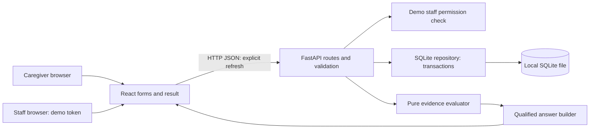

# MVP Architecture: Request-Specific Availability Verification

Design budget: **six hours, one developer: Pantha Protick**. This is a proposed architecture, not an implementation or deployment completion claim. Sources: [MVP](mvp.md), [proposition](proposition.md), [Pantha's skills](team_skills.md), and [preferred stack](prefered_stacks.md).

**Use the existing React/Vite shell, one FastAPI process, a small deterministic comparison function, and one local SQLite file.** Connect caregiver request → staff report → saved evidence → qualified answer. No model service, remote inventory feed, background worker, or realtime channel is required.

Pantha has documented backend, database, and systems strengths. Frontend skill is unlisted. The other team members in the skills file are not available. “Parallel development” therefore means independently testable boundaries and matching fixtures; it does not create additional developer hours.

## 1. Scope, evidence, and current starter

### Verified by file inspection

- `frontend/package.json` contains React/Vite and the current UI is JavaScript. Reuse this setup; do not add a TypeScript migration.
- `backend/pyproject.toml` specifies Python >=3.12 and already includes FastAPI/Uvicorn plus optional model/PostgreSQL libraries.
- `backend/app/core/database.py` conditionally configures an async PostgreSQL engine. This is configuration code, not evidence of a working remote database.
- `backend/app/api/routes.py` reads/writes its sample items in memory even when its database dependency is configured.
- `frontend/src/services/api.js` fabricates a local item after failed creation and substitutes example idea responses after errors. These patterns cannot be reused for MVP evidence writes: they hide failure behind apparent success.
- This architecture file was empty before this design. The existing starter has not been run or validated in this review.

### Assumptions and unknowns

Assume a local demo laptop, one pharmacy, three synthetic products, small request volume, and two browser contexts controlled by the presenter. Runtime compatibility, build/startup, available frontend skill, and any working remote database remain unverified. A staff credential represents a **simulated actor**, not a verified pharmacy professional. Physical count accuracy and improved caregiver comprehension remain outside what code alone proves.

Use one canonical unit per product, positive integer requests, and nonnegative integer observations. There are no conversions, substitutions, holds, corrections, or live source adapters. A completed report is immutable; an error requires a new enquiry.

## 2. Contract blueprint — freeze before implementation

These contracts precede the component breakdown so UI mocks and backend work agree. This follows the [hackathon-problem-solver skill](</C:/Users/Administrator/.codex/skills/hackathon-problem-solver/SKILL.md>). The models below are a blueprint inside this document, not functional application code.

The expanded [integration contracts](api_contracts.md) are authoritative for implementation: they include all boundary schemas, complete mocks, strict timestamp/flag/UUID validation, and standardized method/media-type errors. Use their refined models rather than independently extending this earlier blueprint.

### Shared rules and ownership

- API prefix: `/api/v1`. JSON only; no bodies on GET. Breaking contract changes require coordinated fixture/client updates; no version-negotiation subsystem.
- Catalog IDs are stable fixture strings (`PHARM-A`, `MED-A`, `CLAIM-A`). Enquiry IDs are canonical lowercase UUID strings generated by the browser **once per new request intent**, before sending. Reuse the same ID/body when recovering an uncertain creation.
- Backend owns catalog lookup, staff attribution, validation, saved evidence, conclusion, and wording. Frontend owns form state and rendering; it cannot supply a conclusion or staff identity.
- Quantities reject strings, booleans, fractions, negatives, and requests of zero. Maximum 10,000 units is a disclosed defensive demo bound, not a clinical limit. Units are exact codes `tablet` or `capsule` in these fixtures; only the selected product's unit is accepted.
- Times are timezone-aware ISO 8601 strings. Store/output UTC; display with timezone, optionally Asia/Dhaka. `observed_at` is staff-reported; `submitted_at`, `created_at`, and `served_at` are server times. Null check time stays unknown; submission time does not replace it. Future observation time is rejected against the server clock; no inferred freshness threshold.
- All fields in the examples/models are required, including fields whose value may be null. Unknown does not become zero or an empty string. Extra fields are rejected.
- Public reads/creation contain synthetic data only. Staff queue/report writes require `Authorization: Bearer <demo-staff-token>`, checked server-side against a backend environment variable and mapped to `STAFF-DEMO`/`PHARM-A`. No token in the source, frontend build variables, URLs, logs, or fixtures. Presenter enters it only in the staff context; keep it in memory.
- This is a local role boundary. Any token holder can act as the simulated staff actor; it is not partner onboarding or professional authentication. Real patient data/public hosting would require a separate access/privacy design.

### Endpoint contracts

| Method/path | Input | Output and behavior | Permission |
|---|---|---|---|
| `GET /health` | None | `HealthResponse`; 200 only after SQLite can be opened/read and schema exists; 503 on readiness failure | Local public |
| `GET /bootstrap` | None | `BootstrapResponse`: one pharmacy, products, seeded claims | Local public |
| `PUT /enquiries/{id}` | `CreateEnquiryRequest` | `EnquiryView`; 201 first creation, 200 identical replay, 409 same ID with changed request | Local public |
| `GET /enquiries/{id}` | UUID path | `EnquiryView`; 404 if not currently saved | Local public |
| `GET /staff/enquiries` | None | JSON array of `EnquiryView`, pending only, oldest first; bounded to this small demo dataset | Staff |
| `PUT /enquiries/{id}/observation` | `ObservationRequest` | `EnquiryView`; 201 first report, 200 identical replay, 409 different second report | Staff for enquiry's pharmacy |

PUT is used for immutable creation at a known address, not for editing. This slightly larger contract avoids a separate idempotency-key table and lets the client inspect an unknown creation by its already-known ID. There is no delete/reset endpoint in the user API.

### Exact interaction examples

`GET /bootstrap` → 200:

```json
{
  "pharmacy": {"id": "PHARM-A", "name": "Synthetic Demo Pharmacy"},
  "products": [
    {"id": "MED-A", "name": "Demo Medicine A", "strength": "10 mg", "form": "tablet", "unit": "tablet"},
    {"id": "MED-B", "name": "Demo Medicine A", "strength": "20 mg", "form": "tablet", "unit": "tablet"},
    {"id": "MED-C", "name": "Demo Medicine C", "strength": "10 mg", "form": "capsule", "unit": "capsule"}
  ],
  "claims": [
    {"id": "CLAIM-A", "pharmacy_id": "PHARM-A", "product_id": "MED-A", "quantity": 12, "unit": "tablet", "recorded_at": "2026-10-07T03:10:00Z", "loaded_at": "2026-10-07T03:15:00Z", "source": "synthetic inventory fixture", "simulated": true}
  ],
  "simulated": true
}
```

Only MED-A has a seeded claim in this example. Missing claims for other products are allowed; absence is not a zero quantity. The pharmacy/products are fixtures, not medical reference assertions. Exact times are demonstration examples, not evidence of an actual check.

`PUT /enquiries/00000000-0000-4000-8000-000000000001` request:

```json
{"pharmacy_id":"PHARM-A","product_id":"MED-A","requested_quantity":6,"unit":"tablet"}
```

→ 201; `GET` on that address returns the same saved evidence with a newly generated `served_at`:

```json
{
  "id": "00000000-0000-4000-8000-000000000001",
  "pharmacy_id": "PHARM-A",
  "product": {"id":"MED-A","name":"Demo Medicine A","strength":"10 mg","form":"tablet","unit":"tablet"},
  "requested_quantity": 6,
  "unit": "tablet",
  "created_at": "2026-10-07T05:00:00Z",
  "served_at": "2026-10-07T05:00:00Z",
  "claim": {"id":"CLAIM-A","pharmacy_id":"PHARM-A","product_id":"MED-A","quantity":12,"unit":"tablet","recorded_at":"2026-10-07T03:10:00Z","loaded_at":"2026-10-07T03:15:00Z","source":"synthetic inventory fixture","simulated":true},
  "observation": null,
  "status": "pending",
  "answer": {"conclusion":"unresolved","reason":"awaiting_check","discrepancy_units":null,"message":"You requested 6 tablets. No staff check has been saved.","limitations":["Synthetic demonstration.","Recorded stock is not a physical check.","No stock reservation or clinical approval."]},
  "simulated": true
}
```

Staff `GET /staff/enquiries` → 200: an array containing the pending `EnquiryView` above. Empty queue response is exactly `[]`. Staff must choose a specific enquiry ID, not “whichever request is latest.”

Staff `PUT /enquiries/00000000-0000-4000-8000-000000000001/observation` request:

```json
{"product_id":"MED-A","unit":"tablet","kind":"checked","obtainable_quantity":4,"observed_at":"2026-10-07T05:02:00Z","unresolved_reason":null}
```

→ 201, complete response:

```json
{
  "id": "00000000-0000-4000-8000-000000000001",
  "pharmacy_id": "PHARM-A",
  "product": {"id":"MED-A","name":"Demo Medicine A","strength":"10 mg","form":"tablet","unit":"tablet"},
  "requested_quantity": 6,
  "unit": "tablet",
  "created_at": "2026-10-07T05:00:00Z",
  "served_at": "2026-10-07T05:02:01Z",
  "claim": {"id":"CLAIM-A","pharmacy_id":"PHARM-A","product_id":"MED-A","quantity":12,"unit":"tablet","recorded_at":"2026-10-07T03:10:00Z","loaded_at":"2026-10-07T03:15:00Z","source":"synthetic inventory fixture","simulated":true},
  "observation": {"product_id":"MED-A","unit":"tablet","kind":"checked","obtainable_quantity":4,"observed_at":"2026-10-07T05:02:00Z","unresolved_reason":null,"staff_id":"STAFF-DEMO","submitted_at":"2026-10-07T05:02:01Z","basis":"staff_reported_obtainable_count","simulated":true},
  "status": "answered",
  "answer": {"conclusion":"insufficient","reason":"checked_below_request","discrepancy_units":-8,"message":"You requested 6 tablets. Staff reported 4 obtainable tablets at 2026-10-07T05:02:00Z. This did not meet the requested quantity at that time. Recorded stock was 12 tablets.","limitations":["Synthetic demonstration.","Staff report is not independently verified.","This check does not reserve stock or guarantee availability on arrival.","Exact identity matching is not clinical approval."]},
  "simulated": true
}
```

`discrepancy_units` = observed minus recorded when both quantities/units are compatible; here `4 - 12 = -8`. It is not the requested shortfall, which is `6 - 4 = 2`. Label these correctly if both are displayed. Saved evidence stays the same on subsequent reads; `served_at` may change.

Alternative report request on a **new** enquiry:

```json
{"product_id":"MED-A","unit":"tablet","kind":"unable_to_check","obtainable_quantity":null,"observed_at":null,"unresolved_reason":"cannot_check"}
```

Its response retains the enquiry/claim envelope above, sets `status` to `unresolved`, and stores that report with server attribution/time, `basis:"unable_to_check"`, and `simulated:true`. Its exact `answer` object is:

```json
{"conclusion":"unresolved","reason":"cannot_check","discrepancy_units":null,"message":"Staff could not complete the check. Availability for this request remains unresolved.","limitations":["Synthetic demonstration.","No obtainable quantity established.","No stock reservation or clinical approval."]}
```

A checked report may have `observed_at:null`; retain the reported count but return `status:"unresolved"`, reason `observation_time_unknown`, and explain the missing time. This is different from being unable to count. No numeric discrepancy is published for evidence that failed the comparison gate.

`GET /health` healthy response:

```json
{"status":"ready","storage":"sqlite"}
```

### Error envelope and transport failure

Every non-success API response uses this shape, including FastAPI validation errors through a small exception handler:

```json
{"error":{"code":"validation_error","message":"requested_quantity must be a positive whole number.","fields":["requested_quantity"]}}
```

| HTTP | Code | Meaning / UI handling |
|---|---|---|
| 422 | `validation_error` | Malformed field, unknown catalog ID, incompatible product/unit, or future time; explain, retain form, do not mutate saved state |
| 401 | `unauthorized` | Missing/invalid staff token; ask presenter to re-enter it; no attribution saved |
| 403 | `forbidden` | Valid actor outside enquiry's pharmacy; no mutation |
| 404 | `not_found` | Enquiry not currently stored; do not interpret as unavailable medicine |
| 409 | `immutable_conflict` | ID reused with different request, or different second report; show saved evidence, require new enquiry for a correction |
| 503 | `storage_unavailable` | Database unavailable/busy/readiness failure; no fabricated success |
| 500 | `internal_error` | Unexpected failure; generic safe message to user and correlated server log |

`fields` is always an array (possibly empty). No raw exceptions, credentials, SQL, or submitted secrets in responses. GET uses a 3-second client deadline; mutations use 5 seconds. These are demo settings, not measured service guarantees. Browser abort/connection loss is **not** a JSON error envelope and does not prove rollback.

On an unknown write outcome, freeze that intent, keep its ID and exact body, and inspect `GET /enquiries/{id}`. After an observation attempt, compare saved observation to the attempted body. A pending/404 read can race an in-flight write; it is not proof that the earlier attempt can never commit. No automatic mutation retry. If inspection cannot settle it, retain “save outcome unknown”; an explicit retry must use the same address and identical body, which the backend handles idempotently. Never create a new ID automatically to hide an uncertain save.

### Exact Pydantic blueprint

Pydantic models define JSON shape/field constraints. Catalog lookup, future-time validation, attribution, request matching, conclusion construction, and transaction rules remain service responsibilities. [FastAPI supports Pydantic request-body models](https://fastapi.tiangolo.com/tutorial/body/); [strict validation](https://docs.pydantic.dev/latest/concepts/strict_mode/) can reject unwanted coercion. Apply strictness to quantities rather than globally rejecting valid JSON timestamp strings.

```python
from datetime import timezone
from enum import Enum
from typing import Annotated, Literal
from uuid import UUID
from pydantic import (
    AwareDatetime, BaseModel, ConfigDict, Field,
    StringConstraints, field_validator, model_validator,
)

Id = Annotated[str, StringConstraints(
    strict=True, pattern=r"^[A-Z][A-Z0-9-]{0,63}$"
)]
Text = Annotated[str, StringConstraints(strict=True, min_length=1, max_length=500)]
RequestedQty = Annotated[int, Field(strict=True, ge=1, le=10000)]
ObservedQty = Annotated[int, Field(strict=True, ge=0, le=10000)]
SignedQty = Annotated[int, Field(strict=True, ge=-10000, le=10000)]

class WireModel(BaseModel):
    model_config = ConfigDict(extra="forbid")

class Unit(str, Enum):
    tablet = "tablet"
    capsule = "capsule"

class Status(str, Enum):
    pending = "pending"
    answered = "answered"
    unresolved = "unresolved"

class Conclusion(str, Enum):
    sufficient = "sufficient"
    insufficient = "insufficient"
    unresolved = "unresolved"

class Reason(str, Enum):
    awaiting_check = "awaiting_check"
    checked_meets_request = "checked_meets_request"
    checked_below_request = "checked_below_request"
    cannot_check = "cannot_check"
    observation_time_unknown = "observation_time_unknown"
    evidence_conflict = "evidence_conflict"

class ReportKind(str, Enum):
    checked = "checked"
    unable_to_check = "unable_to_check"

class Pharmacy(WireModel):
    id: Id
    name: Text

class Product(WireModel):
    id: Id
    name: Text
    strength: Text
    form: Text
    unit: Unit

class Claim(WireModel):
    id: Id
    pharmacy_id: Id
    product_id: Id
    quantity: ObservedQty | None
    unit: Unit
    recorded_at: AwareDatetime | None
    loaded_at: AwareDatetime
    source: Text
    simulated: Literal[True]

class BootstrapResponse(WireModel):
    pharmacy: Pharmacy
    products: list[Product]
    claims: list[Claim]
    simulated: Literal[True]

class CreateEnquiryRequest(WireModel):
    pharmacy_id: Id
    product_id: Id
    requested_quantity: RequestedQty
    unit: Unit

class ObservationRequest(WireModel):
    product_id: Id
    unit: Unit
    kind: ReportKind
    obtainable_quantity: ObservedQty | None
    observed_at: AwareDatetime | None
    unresolved_reason: Literal["cannot_check"] | None

    @field_validator("observed_at")
    @classmethod
    def utc_time(cls, value):
        return value.astimezone(timezone.utc) if value is not None else None

    @model_validator(mode="after")
    def coherent_report(self):
        if self.kind == ReportKind.checked:
            if self.obtainable_quantity is None or self.unresolved_reason is not None:
                raise ValueError("checked requires count and null unresolved_reason")
        else:
            if (self.obtainable_quantity is not None or self.observed_at is not None
                    or self.unresolved_reason != "cannot_check"):
                raise ValueError("unable_to_check requires null count/time and cannot_check")
        return self

class Observation(ObservationRequest):
    staff_id: Id
    submitted_at: AwareDatetime
    basis: Literal["staff_reported_obtainable_count", "unable_to_check"]
    simulated: Literal[True]

    @model_validator(mode="after")
    def matching_basis(self):
        expected = ("staff_reported_obtainable_count"
                    if self.kind == ReportKind.checked else "unable_to_check")
        if self.basis != expected:
            raise ValueError("basis does not match report kind")
        return self

class Answer(WireModel):
    conclusion: Conclusion
    reason: Reason
    discrepancy_units: SignedQty | None
    message: Text
    limitations: list[Text]

class EnquiryView(WireModel):
    id: UUID
    pharmacy_id: Id
    product: Product
    requested_quantity: RequestedQty
    unit: Unit
    created_at: AwareDatetime
    served_at: AwareDatetime
    claim: Claim | None
    observation: Observation | None
    status: Status
    answer: Answer
    simulated: Literal[True]

class ErrorDetail(WireModel):
    code: Literal[
        "validation_error", "unauthorized", "forbidden", "not_found",
        "immutable_conflict", "storage_unavailable", "internal_error"
    ]
    message: Text
    fields: list[Text]

class ErrorResponse(WireModel):
    error: ErrorDetail

class HealthResponse(WireModel):
    status: Literal["ready"]
    storage: Literal["sqlite"]
```

Path UUIDs must additionally pass canonical-string validation; Python's UUID parsing alone accepts more representations. Normalize times to UTC before comparison/storage. Response consistency is enforced by one answer-builder and tests; schema validity alone does not prove a truthful conclusion.

## 3. Components and responsibilities



These are modules inside one app, not individually deployed services.

| Component | Responsibility | What it must not own |
|---|---|---|
| React caregiver section | Select exact product/quantity, initiate enquiry, preserve active ID, refresh/display qualified result | Local authoritative stock, success fallbacks, clinical interpretation |
| React staff section | Enter demo credential, load pending enquiries, choose ID, submit count/time or unable-to-check | Changing caregiver request, overwriting completed report, self-selected staff attribution |
| Small fetch wrapper | Relative API URLs, deadline, decode JSON errors, preserve unknown outcome | Automatic POST/PUT retries, replacing network error with a fake response |
| FastAPI route boundary | Parse contracts, authorize, call service, map errors, return view | Duplicating comparison rules per endpoint |
| Enquiry service/repository | Create immutable enquiry, capture claim/product snapshot, atomic report insertion, replay/conflict handling | Network inventory lookups, medical reasoning |
| Pure evaluator/answer builder | Gate evidence, compare exact units/count, derive status/reason/message | Database writes, model calls, guessing missing quantities |
| SQLite file | Durable shared source of truth for both actors | Acting as proof of physical stock |
| Seed/test fixtures | Reproducible cases and demo initialization | Silently replacing live write outcomes |

Suggested implementation locations, adapting existing files rather than creating layers by habit:

```text
backend/app/
  main.py             # lifespan/readiness, API + demo static assets
  models/schemas.py   # blueprint above
  api/routes.py       # thin handlers and demo permission dependency
  core/database.py   # local connection/transaction helpers
  services/enquiries.py  # immutable writes and view construction
  services/evidence.py   # pure gates/comparison/templates
backend/data/demo.sqlite3
backend/tests/        # contracts, evaluator, transaction behaviors
frontend/src/
  App.jsx             # caregiver + staff sections
  services/api.js    # shared transport, explicit errors
  index.css           # small plain stylesheet
docs/                 # architecture, fixture scenarios, demo evidence
```

Split UI components only when readability requires it. Do not add generic repositories, event buses, interfaces for hypothetical providers, or a frontend global store.

## 4. Data flow and decision semantics

1. Browser loads pharmacy/products/claims. Display the original record as indicative evidence.
2. Caregiver selects MED-A and 6 tablets; browser generates an ID, records it in the current URL before the write, and sends PUT. Backend validates exact identity/unit and snapshots the selected product and claim in the enquiry transaction.
3. Backend returns pending. Staff refreshes queue, selects that same ID, reads exact identity/request, and supplies the simulated observation.
4. Backend checks credential/pharmacy and product/unit/time; under a short transaction it inserts the first report or detects replay/conflict. Commit succeeds before returning success.
5. Backend reads committed evidence and derives the answer. Caregiver explicitly refreshes the saved enquiry. No separate result table or client-side recomputation.

| Saved evidence | Derived workflow status | Conclusion |
|---|---|---|
| No report | pending | unresolved / awaiting_check |
| Unable-to-check report | unresolved | unresolved / cannot_check |
| Checked count but unknown observation time | unresolved | unresolved / observation_time_unknown |
| Valid matched report, quantity >= requested | answered | sufficient **at observation time** |
| Valid matched report, quantity < requested, including zero | answered | insufficient **at observation time** |
| Unexpected contradictory/invalid saved evidence | unresolved | unresolved / evidence_conflict; log integrity fault |

Recorded 12 versus checked 4 is an expected **discrepancy**, not automatically a conflict. A different second report is rejected, not reconciled. A different product/unit submission is rejected before saving. Conflicting fixture evidence is tested at the evaluator boundary; do not add a second-report interface merely to demonstrate it.

An old valid check remains a statement about its observation time. Show the time prominently and explain present/future stock is not established. There is no invented validity window or age-derived confidence percentage. Missing original claim/time does not erase an otherwise valid checked observation; show that original evidence as unknown. A missing check time prevents a time-qualified sufficiency answer.

## 5. Database and storage

Use Python's standard-library `sqlite3`, explicit parameterized statements, and small transactions. SQLite is documented as a disk-backed database without a separate server process; transaction control is available through the Python interface. [Python sqlite3 documentation](https://docs.python.org/3/library/sqlite3.html).

| Table | Minimal stored content / constraints |
|---|---|
| `products` | ID PK; name, strength, form, canonical unit. Immutable synthetic catalog during demo |
| `claims` | ID PK; pharmacy/product; quantity nullable; unit; recorded time nullable; loaded time; source; simulated flag. At most one fixture claim per pharmacy/product |
| `enquiries` | UUID text PK; pharmacy/product/request amount/unit; server creation time; immutable product snapshot JSON and optional claim snapshot JSON |
| `observations` | Enquiry ID PK + FK; product/unit; report kind; nullable count/time/reason; server staff ID/submission time; basis; simulated flag |

One pharmacy and the fixed staff mapping can be configuration constants; a table for each would add no useful behavior. Snapshot JSON is generated from validated models by the server; it prevents later fixture edits changing the original evidence. Parent product IDs still remain explicit for validation. No stored status/conclusion: deriving them prevents a committed report and stale status from disagreeing.

Enable foreign keys on every connection; enforce positive/nonnegative range checks and one-report uniqueness in SQL as well as input validation. Use one connection per request/transaction, always closed; do not share a global mutable connection. Use short synchronous repository operations through normal `def` route handlers, rather than blocking the async event loop with database operations. No awaited network calls inside a transaction.

For writes, use `BEGIN IMMEDIATE`, compare immutable normalized payload fields, and insert/commit as one operation. A concurrent second writer must see the saved first report after acquiring the lock: identical body → replay; different body → 409. Server-generated submission time is excluded from replay comparison. A repeated payload with a changed observation time is different; UI freezes the original submitted body.

Set a bounded SQLite lock timeout (for example 2 seconds); map lock/unavailability to 503. Do not silently fall back to in-memory storage. Fail readiness/startup if storage is not usable. One Uvicorn worker is enough. WAL, connection pools, async drivers, migrations, backups-as-a-service, and query optimization projects are unnecessary here.

Initialization creates the schema and inserts missing fixtures without resetting enquiries. Demo reset is an explicit local maintenance action with server stopped, inside the named demo data directory, followed by reseeding. Use a dedicated test database; do not run tests against the demo file. No web-accessible wipe route.

## 6. Technology choices and simpler alternatives

The request to justify why a simpler alternative is insufficient must not become an excuse for complexity. Where the simpler alternative **is sufficient**, keep it or treat the chosen tool as reuse convenience.

| Choice | Why / trade-off | Simpler alternative and whether it is sufficient |
|---|---|---|
| Existing React + Vite + JavaScript | Reuses inspected shell; simple local form state, native fetch, plain CSS. Cost: a build pipeline and UI familiarity | Backend-served HTML is sufficient for the proposition. Keep React only while reuse is faster; switch to one small backend-served interface if UI setup blocks the 90-minute vertical-slice gate. Do not maintain both |
| FastAPI + Pydantic | Fits Pantha's Python/backend strengths and existing starter; central request contracts and validation. Cost: framework/schema dependency | A frontend-only app is insufficient for a separately enforced staff-write boundary and trustworthy shared state. A small alternative Python web framework could work; switching frameworks has no demonstrated benefit |
| SQLite + standard-library driver | One local server, small data, atomic writes, easy inspection; cost: explicit SQL and local filesystem ownership | In-memory state could prove a continuously running slice, but loses evidence on restart. JSON files require homemade lock/atomicity/replay handling. SQLite cheaply covers both reliability and mutation safety |
| Deterministic Python comparison | Exact counts, units, and reasons are auditable and testable; cost: explicitly enumerated supported cases | Client-only comparison is insufficient because authoritative result can diverge or be manipulated. No AI is required; a model adds uncertainty without addressing physical truth |
| HTTP JSON + explicit refresh | Simple request inspection and bounded failure behavior; cost: staff/caregiver must refresh | One form with no shared API/state cannot connect independent actors. Refresh is sufficient; WebSockets/SSE/polling are not needed |
| Fixed server-checked staff token | Minimal separation of caregiver submission from attributed staff writes; cost: manual credential entry and no individual professional verification | A visible role dropdown alone is insufficient because it does not restrict writes. Accounts/JWT/OAuth are unnecessary for this disclosed loopback-only simulation |
| Relative `/api/v1` URL; local proxy while developing | Keeps client contract stable and removes separate URL conventions. Vite supports path proxy configuration. [Vite docs](https://vite.dev/config/server-options.html#server-proxy) | Explicit cross-origin URLs/CORS can work, but add configuration mistakes. Same-origin built demo is sufficient; no reverse proxy product required |
| Existing `uv` project/lock and frontend lockfile | Reuse installed project conventions; preserve reproducibility. Cost: tool/runtime availability must be verified | Existing working virtual environment + pip is sufficient if uv is blocked. Do not replace package management during the deadline; no speed benchmark is assumed |

**Scoped changes from preferred stack:** do not use Neon/asyncpg/SQLAlchemy, Gemini SDK, TanStack Query, Axios, Zustand, Tailwind/component libraries, WebSockets, SSE, or Docker unless already-working reuse demonstrably reduces work. Installed dependencies need not be removed for the demo; disconnect irrelevant imports/services from the MVP startup path. The starter's remote engine and Gemini service should not be prerequisites for starting this workflow.

Direct SQL suffices for four tiny tables. If a verified working PostgreSQL enquiry implementation already exists when implementation begins, reassess before migrating it; current inspection found only generic configuration and memory items, not that implementation.

## 7. External dependencies and deployment

### Dependencies

Runtime: local Python environment with FastAPI/Pydantic/Uvicorn, bundled React assets, and writable SQLite file. Development/build: existing Node/npm/Vite and uv environment. Package downloads may require connectivity during setup; the finished demo should not require internet. Use installed/locked dependencies first and test actual startup/build instead of upgrading packages.

There are **no application-time third-party calls**: no medicine API, mapping API, model endpoint, Neon database, SMS, pharmacy partner, or CDN asset. The professional/physical-check source is simulated and explicitly labeled. Offline demo readiness still requires testing; it is not established merely by this dependency list.

### Development and demo

- Development: FastAPI on loopback port 8000, Vite on loopback 5173, `/api` development proxy to backend. All fetches use relative `/api/v1`; staff header survives the proxy.
- Demo: build React once, then FastAPI serves the built assets and the API from **one origin/process**, bound to `127.0.0.1:8000`. Route API first; serve app at `/` and its asset paths. Use a query parameter for current enquiry rather than adding route-fallback complexity.
- Existing root `/docs` redirect must change when implementing static UI serving. Interactive API docs remain a debugging aid; their default external assets are not part of the offline golden path.
- Start without hot reload and with one worker; show caregiver and staff in separate browser profiles/windows so credential/state isolation is visible. Do not expose to LAN/cloud by changing the bind address during the pitch.
- Planned run commands: `npm run build` in frontend; `uv run uvicorn app.main:app --host 127.0.0.1 --port 8000` in backend. These rely on the proposed static-serving/config changes and are not currently verified launch instructions.
- Configure absolute SQLite path, demo staff token, and demo mode in backend environment. Do not embed credentials via `VITE_*`. Startup verifies schema/storage; seed only deliberately. Keep logs on backend with method/path/enquiry ID/error code, never auth headers.
- Rehearse startup, clean seed, fresh request, restart with retained evidence, and a disconnected-network walkthrough. Screenshots/short recording are backup evidence only; disclose when showing recorded behavior.

Cloud hosting, public HTTPS, Docker orchestration, remote PostgreSQL, and multi-worker deployment are not needed to satisfy the local MVP. If judges later require a public URL, that is a new constraint; verify persistent storage, access control, and hosting availability rather than promising it now.

## 8. Failure points and controls

| Failure / stress case | Control and visible outcome | Required verification |
|---|---|---|
| Wrong product/strength/unit | Catalog selection + backend ID/unit match; 422 before save | Two similar products and wrong-unit API case |
| String/boolean/fraction/negative count | Strict quantity constraints; unknown separate from zero | Contract tests and invalid browser input |
| Stale/missing stock claim | Preserve source/time/unknown; never treat recorded amount as checked | Old and missing fixture claims |
| Unknown/future observation time | Unknown produces unresolved; future input rejected; submission time kept separate | Null, naive, and future timestamp cases |
| Browser double click/concurrent writers | Disable busy form plus SQL transaction/PK guarantee; identical replay or 409 | Concurrent report submissions, not just sequential calls |
| Timeout after commit | Freeze intent, inspect saved ID; show unknown until settled; no automatic retry | Simulate dropped response after server save |
| Backend/database stops | Error shown, form retained, no fabricated observation/result | Stop backend and deny/unavailable database test |
| UI refresh shows old result | Explicit fetch; disable API response caching (`Cache-Control: no-store`); show saved evidence times | Same enquiry before/after staff save in two contexts |
| Caregiver impersonates staff | Staff token server check; attribution from backend mapping | Unauthorized direct write attempt |
| Report correction tries to overwrite | Immutable second-write conflict; new enquiry needed | Changed second payload must preserve original |
| Database path/reset mistake | Absolute named path, separate test DB, explicit stopped-server reset | Restart and fixture initialization preserves saved request |
| Client/server contract drift | Shared exact fixtures + schema validation; no mock-only fields | Same fixtures parse through response models/client |
| UI/API errors look successful | Replace starter's synthetic fallbacks with explicit transport errors | Failed write must not create a local success card |
| Unsafe certainty/medical inference | One backend answer builder, explicit time/limits/simulation | Sufficient, insufficient, pending, unresolved wording review |
| Staff report is physically wrong | No software proof; label attribution/limits | Unknown without real supervised check; do not claim resolution |

Bounded future extensibility comes from separating transport, persistence, and pure evidence rules. New pharmacy integrations, repeat checks, holds, or real accounts need new contracts and operational rules; they are not “just another endpoint.” Do not prebuild their abstractions.

## 9. Mocking and independent integration

| Can be mocked | Conditions |
|---|---|
| Product/catalog and inventory claims | Local disclosed fixtures with distinct strength/form, old/missing records; no unauthorized real-source extraction |
| Physical check and staff identity | Presenter acts as staff and enters simulated count; labels always visible |
| Frontend transport during UI development | One temporary in-process mock implementing the same client functions/fixtures; explicit mock mode; no extra mock-server dependency |
| Error/delay/conflict cases | Test injection with controlled fixtures; never hidden as a fallback during live demo |
| Human evaluation material | Prepare baseline cases; actual participants cannot be invented or replaced with model-generated “validation” |

What cannot be mocked in the claimed working demo: request storage, staff-write authorization, same-enquiry retrieval, atomic report acceptance, quantity comparison, preservation of original evidence, and truthful error handling. A prewritten result card does not prove these.

Contract-first parallelizable work boundaries:

1. Freeze models/examples above and expected fixture answers first (approximately 30 minutes).
2. UI can render fixtures while backend checks the same JSON and implements the evaluator/repository. With one developer these are sequential work segments, not simultaneous teammate tasks.
3. Keep `services/api.js` function names/results identical between temporary mock and HTTP versions; change only the selected implementation. Do not independently calculate answers in the UI mock.
4. Switch to real API early and complete request → report → result by the MVP's 90-minute gate. Mock mode must be off and clearly inspectable before claiming integration.
5. Use test-specific temporary databases for backend work. Freeze shared fixtures when UI and backend agree; avoid generated-client tooling for this tiny contract.

No additional agents/developers are assumed. No multi-service synchronization is needed.

## 10. What absolutely must work for the demo

- Caregiver selects exact MED-A, requests 6 tablets, creates a real saved enquiry, and sees pending rather than unavailable.
- Staff context retrieves that same ID and saves a simulated count of 4 with its time, through the protected API.
- Caregiver refresh returns insufficient at observation time; original record 12 and observation 4 remain separately visible. Discrepancy is -8, not the request shortfall of 2.
- A fresh enquiry with count >= requested returns sufficient at its observation time; zero count returns insufficient; unable-to-check and unknown-time cases remain unresolved.
- Invalid identity/unit/count/time and unauthorized report attempts cannot produce a saved qualified answer.
- Identical replay is harmless; differing replay cannot replace evidence. A lost response never creates client-side fake success.
- Build/startup/reset are repeatable and the actual browser journey works with third-party connectivity removed.
- Presenter explains what is implemented versus simulated, no reservation/clinical guarantee, no verified real-world acquisition benefit, and no assumed human-validation result.

Use the MVP's six-hour allocation: 30 minutes contracts, 60 minutes vertical slice, 90 minutes core evidence, 60 minutes failures, 60 minutes tests/evaluation material, 60 minutes rehearsal. The final two hours remain protected. If the slice is late, simplify presentation before compromising evidence integrity; add no optional infrastructure.

**Acceptance evidence:** focused contract/evaluator/repository checks plus the two-context browser journey. Tests should establish observable invariants, not duplicate every function. Human comprehension comparison is separate and remains unverified unless actually performed.
